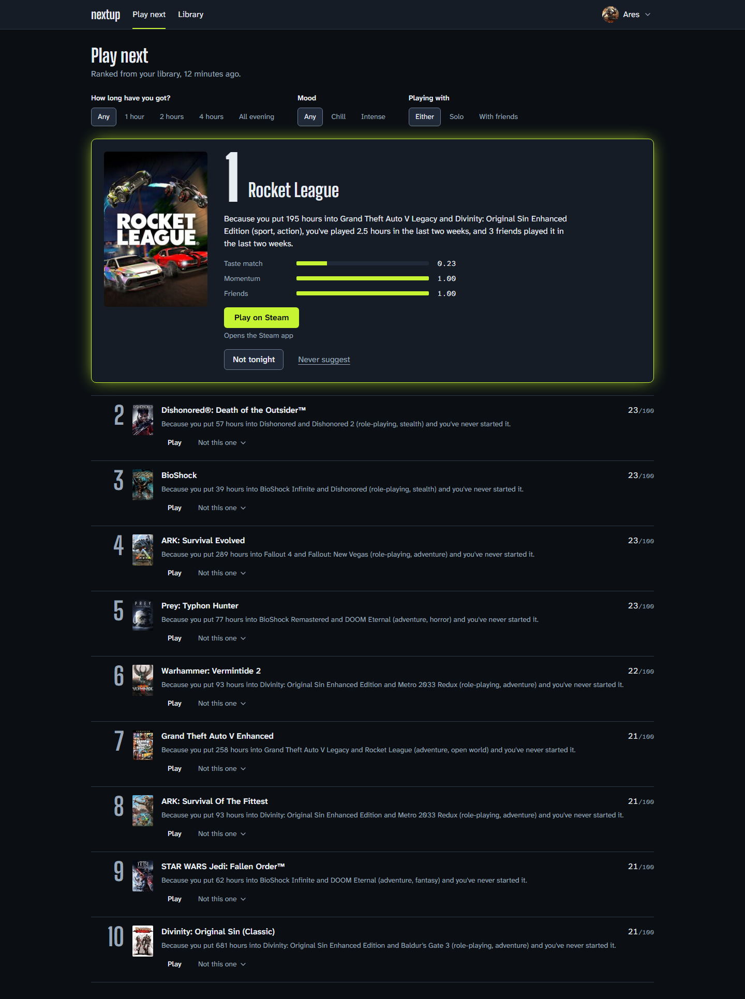
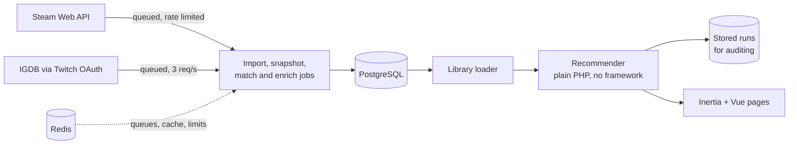

# nextup

**Ranks the games you already own by what you will actually play next, and explains every pick.**

Most of a Steam library never gets played. nextup reads your library and playtime, learns your taste from the games
you put real hours into, and answers one question: _what should you play tonight?_ Every pick comes with its reason
in plain English and the numbers behind it.



> Not deployed yet. A demo mode (a private sample library, no Steam account needed) is built in, and the
> production setup is ready in [docs/deployment.md](docs/deployment.md).

## Does it work?

Offline evaluation on a real 130-game library: each of the 43 games played for 10+ hours is hidden in turn and
ranked against the ~45 games the user has never played. The question is "would nextup have picked the game you
went on to love?" ([method](docs/eval/method.md), [latest results](docs/eval/results.md)).

| Ranker                   | Hit rate @5 | Hit rate @10 | NDCG@10   | MRR       | Mean rank |
| ------------------------ | ----------- | ------------ | --------- | --------- | --------- |
| **nextup**               | **0.395**   | **0.581**    | **0.392** | **0.357** | **12.3**  |
| Tag overlap (unweighted) | 0.140       | 0.256        | 0.109     | 0.099     | 19.9      |
| Random                   | 0.116       | 0.163        | 0.067     | 0.070     | 26.1      |

The first version scored 0.116 at hit rate @5, no better than random. Switching signals off one at a time showed that
"fits tonight" (favouring short games) was burying the long games people love, so it now counts only when the user
says how long they have. The before and after is in [docs/decisions.md](docs/decisions.md). A time-split
backtest (rank the library as it was 90 days ago, check what was played since) is built and needs 90 days of
nightly playtime snapshots.

## How it ranks

The score is a weighted sum of named signals, each between 0 and 1, so the biggest contributions _are_ the
explanation. No black box to justify after the fact. Full spec: [docs/recommender.md](docs/recommender.md).

| Signal             | What it measures                                                                                                                                                                                                         |
| ------------------ | ------------------------------------------------------------------------------------------------------------------------------------------------------------------------------------------------------------------------ |
| Taste match        | Cosine similarity between the game's IGDB tags and a taste vector built from the games you put hours into, with TF-IDF so tags on everything (Action, Adventure) count less. Leave-one-out: a game never matches itself. |
| Momentum           | Started recently and not finished: recent hours (from snapshots or Steam) and a recency decay.                                                                                                                           |
| Fits tonight       | Hours left to finish against the time you said you have. Only when you pick a time.                                                                                                                                      |
| Mood match         | Share of the game's genres and themes that suit a chill or intense evening, when you pick a mood.                                                                                                                        |
| Friends            | Friends who played it in the last two weeks (counted, never named).                                                                                                                                                      |
| Fresh start        | A nudge towards games you own but never really started.                                                                                                                                                                  |
| Mismatch (penalty) | Similarity to games you tried briefly and abandoned.                                                                                                                                                                     |

Feedback changes the next list: _Not tonight_ hides a pick for a day and then fades it back, _Never suggest_ hides it
until undone, _Playing it_ keeps it near the top for a few days.

## Architecture



- **The recommender is plain PHP** in `app/Recommender/` with no Laravel imports (an architecture test enforces it),
  so the scoring can be read and unit-tested on its own. The evaluation harness in `app/Evaluation/` is the same.
- **External APIs are never called while serving a page.** Imports, nightly playtime snapshots, IGDB matching and
  friend activity all run in queued jobs behind Redis rate limiters, with backoff and `Retry-After`.
- **Steam only reports lifetime playtime,** so a nightly snapshot records changes; sessions and "recent hours" are
  derived from the differences. Snapshots are written only when playtime changes (about 95% fewer rows).
- **Secrets stay out of logs and errors.** API clients rethrow without URLs, a log processor redacts keys, and
  tests force blank keys and fail on any unfaked HTTP request.

More detail: [docs/architecture.md](docs/architecture.md). Every real trade-off, with what was rejected:
[docs/decisions.md](docs/decisions.md).

## Stack

- Laravel 13, PHP 8.5, PostgreSQL 17, Redis 7
- Inertia 3 with server-side rendering, Vue 3, TypeScript (strict), Tailwind CSS 4, GSAP for the landing hero
- Steam OpenID login (Socialite), Steam Web API, IGDB
- Pest (630+ tests), Larastan level 9, Pint, vite-plus lint and format, GitHub Actions
- Docker Compose with Caddy and FrankenPHP for production

## Run it locally

Requirements: PHP 8.4+ with `pdo_pgsql` and `redis`, Composer, Node 22+, Docker. The app is served by
[Laravel Herd](https://herd.laravel.com) at `https://nextup.test`.

```bash
docker compose up -d            # Postgres 17 on port 5433, Redis 7 on 6379
composer install
cp .env.example .env
php artisan key:generate
php artisan migrate
npm install
npm run dev
```

In two more terminals:

```bash
php artisan queue:work
php artisan schedule:work
```

Click **Try the demo** to use a sample library without any keys. To use your own library, add `STEAM_API_KEY` and
(optionally, for tags and covers) `IGDB_CLIENT_ID` and `IGDB_CLIENT_SECRET` to `.env`. Tests never need them.

Run the evaluation on a signed-in user's library:

```bash
php artisan eval:run            # print the tables
php artisan eval:run --write    # also write docs/eval/results.md
```

## Quality gates

Run before every commit and in CI (Pest against a Postgres service container):

```bash
./vendor/bin/pint --test
./vendor/bin/phpstan analyse --memory-limit=1G
./vendor/bin/pest
npm run build
npm run check          # lint and format (vite-plus)
npm run types:check    # vue-tsc
```

## Docs

- [PLAN.md](PLAN.md): how it was built, phase by phase
- [docs/recommender.md](docs/recommender.md): the ranking spec
- [docs/eval/method.md](docs/eval/method.md) and [results](docs/eval/results.md): evaluation
- [docs/architecture.md](docs/architecture.md): tables and data flow
- [docs/decisions.md](docs/decisions.md): trade-offs and why
- [docs/design.md](docs/design.md): design direction
- [docs/deployment.md](docs/deployment.md): production Docker setup and VPS runbook

## Credits

Game data and cover art from [IGDB](https://www.igdb.com). Library and friend data from the Steam Web API. nextup is
not affiliated with Valve or Twitch. Built by [Oscar Freeman](https://ojfdigital.co.uk).
